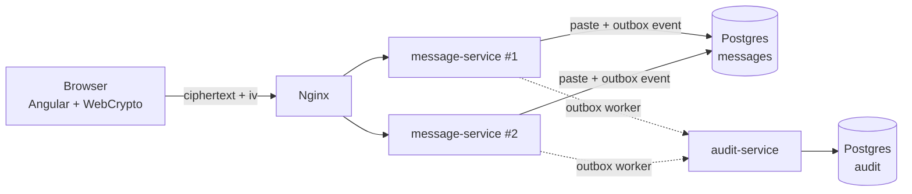

# BurnAfter

**Share a secret as a link that self-destructs after it's read. It's encrypted in your browser, so the server never knows what you sent.**

1. You write a message. **Your browser encrypts it** before it leaves your machine.
2. You get a link. The **decryption key is in the link**, after the `#`.
3. The recipient opens it once, the browser decrypts it locally, and **the server deletes it**.

The server stores only ciphertext it has no key for. A database leak would expose only encrypted blobs, most of them already deleted.

```
https://host/p/3f2a…c91e#Qm9vb…kE
               └─ id ─┘ └─ key ─┘
                         never sent to the server
```

## 1. Encryption (in the browser)

- **AES-256-GCM via WebCrypto.** The browser generates a random key and IV, encrypts locally, and uploads only `{ciphertext, iv}`.
- **Tamper-proof.** GCM is authenticated encryption, so if the server changes the ciphertext, decryption fails instead of returning a corrupted message.
- **The key never reaches the server.** It sits in the URL fragment (`#…`), which browsers don't include in HTTP requests, so it never shows up in logs or the database.
- **Password mode.** The key is derived from a password and a random salt with PBKDF2-SHA256 (150k iterations), so the link on its own can't open the message.
- **Small and auditable.** All the crypto is about 70 lines in [`crypto.util.ts`](frontend/src/app/shared/crypto.util.ts).

## 2. Microservices (on the server)

**Burn after reading.** The last read deletes the row in the same transaction. Optimistic locking means only one of 20 simultaneous readers gets the message. The read endpoint gives the same response shape and timing whether a message exists or not, so it doesn't reveal which IDs are real.

**Reliable audit trail (transactional outbox).** The message-service has to send an audit record (IDs and timestamps only) to a separate audit-service, even when the audit-service is down:

1. The paste and an outbox event are saved **in one transaction**, so the request never waits on the audit-service.
2. Both message-service instances process the outbox with `SELECT … FOR UPDATE SKIP LOCKED`, so they share the work without handling the same event twice.
3. Failed deliveries are **retried with backoff**, and a **circuit breaker** stops calling the audit-service while it's down.
4. Delivery is at-least-once, so the audit-service stores each event once (`ON CONFLICT DO NOTHING`) and ignores duplicates.

## Architecture



Angular 20 · Java 21 / Spring Boot 4 · PostgreSQL 16 · Resilience4j · Prometheus + Grafana · k6 · Docker Compose

## Quick start

```bash
cp .env.example .env
docker compose up --build
```

- UI: http://localhost
- Grafana dashboard: http://localhost:3000
- Prometheus: http://localhost:9090

## Demo: audit-service outage

```bash
k6 run load-tests/demo.js            # 30 messages/s for 3 minutes
docker compose stop audit-service    # ~30s in
docker compose start audit-service   # ~80s in
```

On the Grafana dashboard, the outbox backlog grows and the circuit breakers open while the audit service is down. The API keeps responding with 0 errors. Once the service comes back, the backlog drains in about 30s and no events are lost.

## Repository layout

```
frontend/          Angular UI and browser crypto
message-service/   Paste API, outbox, retry + circuit breaker
audit-service/     Idempotent audit consumer
monitoring/        Prometheus + Grafana config
load-tests/        k6 scenarios
```

## Lessons learnt

- **At-least-once delivery needs an idempotent consumer.** Duplicate events used to be counted as lost.
- **A circuit breaker needs timeouts.** A hanging call never fails, so the breaker never opened.
- **Framework upgrades can silently switch features off.** On Spring Boot 4, Flyway migrations and Resilience4j metrics stopped running.
- **Backoff that wasn't.** A base of 0 meant `0^n = 0`, so every retry fired straight away.

## Known limitations

- A compromised server could serve malicious JavaScript, which is a limit of all browser-based encryption.
- A wrong password still uses up the view, because the server can't check a password it never sees.
- The full link, key included, stays in the recipient's browser history.
