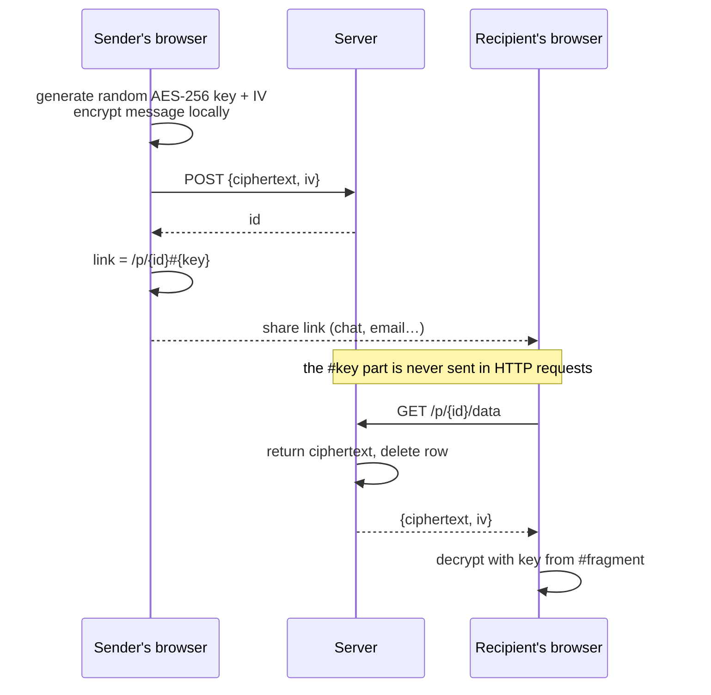
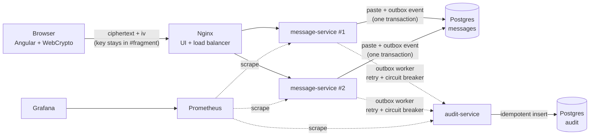

# BurnAfter

**Share a secret as a link that self-destructs after it's read, encrypted in your browser, so the server never knows what you sent.**

## Why

Passwords, API keys and private notes get shared over chat and email every day, and they stay there forever: in message history, backups and inboxes. BurnAfter replaces the secret with a link:

1. You write the message. **Your browser encrypts it** before anything leaves your machine.
2. You get a link. The **decryption key is inside the link**, after the `#`.
3. The recipient opens it once, the browser decrypts it locally, and **the server deletes it**.

The server stores only ciphertext it has no key for. A database leak, a curious admin or a court order would expose only encrypted blobs, most of them already deleted.

## What the server knows

| | Server sees it? |
|---|---|
| Message content | ❌ Only AES-GCM ciphertext |
| Decryption key | ❌ Lives in the URL fragment; browsers never send it |
| Password (password mode) | ❌ Used only in the browser to derive the key |
| That *a* message exists, its size, expiry and remaining views | ✅ Needed to enforce burn-after-read and expiry |

---

## How it works

### 1. Zero-knowledge encryption (browser)



```
https://host/p/3f2a…c91e#Qm9vb…kE
               └─ id ─┘ └─ key ─┘
                         never sent to the server
```

- The browser generates a random **AES-256-GCM** key and a 12-byte IV with the WebCrypto API, encrypts locally, and sends only `{ciphertext, iv}`. All of the cryptography is in ~70 lines: [`crypto.util.ts`](frontend/src/app/shared/crypto.util.ts).
- **GCM is authenticated encryption:** a modified ciphertext fails to decrypt instead of producing garbage, so the server can't tamper with a message undetected.
- The key goes in the **URL fragment** (`#…`). Browsers never send the fragment in HTTP requests, so it never reaches Nginx logs, application logs or the database.
- **Password mode:** the key is derived with **PBKDF2-SHA256 (150k iterations)** from a password plus a random salt. The link carries only `#pwd:<salt>`, so the link alone isn't enough to read the message.
- The server only checks structure (valid base64, 12-byte IV, size limit). It cannot check content.

### 2. Burn after reading (server)

- Each read consumes a view. At zero views, or with burn-after-read, the row is deleted in the same transaction ([`PasteService.data`](message-service/src/main/java/com/burnafter/message_service/service/PasteService.java)).
- **Concurrent reads are safe:** `Paste` uses optimistic locking (`@Version`). If 20 clients open a one-time link at the same moment, exactly one gets the ciphertext.
- **Side-channel hardening** on `GET /api/pastes/{id}/data` ([`PasteController`](message-service/src/main/java/com/burnafter/message_service/controller/PasteController.java)): the response is always `200` with the same shape whether the message exists, was already read, expired, or the ID is malformed. It adds random padding and a randomized minimum response time, so status codes, response sizes and timing don't reveal whether a message exists.
- The reader must click **Open**, so link-preview bots in chat apps don't burn the message.

### 3. Behind the link: a reliable audit trail (transactional outbox)

The server knows nothing about the content, but it must still be able to **prove a message was created**. Every message produces an audit record in a separate audit service, containing only IDs and timestamps, never content. That record has to arrive even when the audit service is down.

Writing to two databases (pastes + audit) can't be atomic. Calling the audit service over HTTP inside the request means a crash or timeout can lose or duplicate the audit record. Instead:

1. **Same transaction:** the paste and an `OutboxEvent` are committed together. The request makes no network call to the audit service ([`PasteService.create`](message-service/src/main/java/com/burnafter/message_service/service/PasteService.java)).
2. **Competing workers:** both message-service instances poll the outbox with `SELECT … FOR UPDATE SKIP LOCKED` ([`OutboxRepository`](message-service/src/main/java/com/burnafter/message_service/outbox/OutboxRepository.java)). They share the work without taking the same rows or blocking each other.
3. **Crash recovery:** events stuck in `PROCESSING` for more than 60s are reclaimed. Delivery is therefore **at-least-once**.
4. **Idempotent consumer:** the audit service inserts with `ON CONFLICT (event_id) DO NOTHING` and acknowledges duplicates with `200` ([`AuditController`](audit-service/src/main/java/com/burnafter/audit_service/controller/AuditController.java)).
5. **Resilience:** a failed delivery is retried with backoff and jitter. A **circuit breaker** (Resilience4j) stops calling a failing audit service. Calls rejected by an open breaker are requeued without using up a retry. HTTP timeouts make sure a hanging call becomes a failure the breaker can see.
6. **Consistency lag** is measured end to end: the audit service records `storedAt − outboxCreatedAt` as a histogram.

---

## Architecture



| Component | Tech |
|---|---|
| Frontend | Angular 20, WebCrypto (AES-GCM, PBKDF2) |
| Services | Java 21, Spring Boot 4, Spring Data JPA, Flyway |
| Resilience | Resilience4j circuit breaker, custom retry with backoff and jitter |
| Data | PostgreSQL 16 (one database per service) |
| Infra | Docker Compose, Nginx |
| Observability | Micrometer, Prometheus, Grafana (provisioned dashboard) |
| Load testing | k6 |

---

## Quick start

Requirements: Docker. Optionally [k6](https://k6.io) for load tests.

```bash
cp .env.example .env
docker compose up --build
```

| URL | What |
|---|---|
| http://localhost | BurnAfter UI |
| http://localhost:3000 | Grafana: "BurnAfter – Outbox & Resilience" dashboard (no login needed) |
| http://localhost:9090 | Prometheus |

---

## Demo: surviving an audit-service outage

```bash
k6 run load-tests/demo.js                 # steady 30 messages/s for 3 minutes
# ~30s in:
docker compose stop audit-service
# ~80s in:
docker compose start audit-service
```

What the dashboard shows:

| Phase | Outbox backlog | Circuit breakers | API |
|---|---|---|---|
| Healthy | ~10 | closed | ~7 ms, 0 errors |
| Audit down | grows ~30/s | **open** within ~10s, probing half-open | **unaffected**: still 0 errors |
| Recovered | drains in ~30s, delivering up to ~80/s | closed | unaffected |

Users never notice the outage. The audit trail is delayed but complete: 0 events lost, duplicates absorbed by the idempotent consumer.

**Burn-after-read race:** run 20 simultaneous reads of the same one-time link; exactly one gets the ciphertext:

```bash
ID=$(curl -s -X POST localhost/api/pastes -H 'Content-Type: application/json' \
  -d '{"kind":"TEXT","ciphertext":"YWJjZGVmZw==","iv":"MDEyMzQ1Njc4OWFi","views":1,"burnAfterRead":true}' \
  | sed -E 's/.*"id":"([^"]+)".*/\1/')
seq 20 | xargs -P 20 -I{} curl -s localhost/api/pastes/$ID/data | grep -c '"ok":true'   # -> 1
```

---

## Experiments

The resilience strategy is selected with a Spring profile (`SPRING_PROFILES_ACTIVE` per service in [`docker-compose.yml`](docker-compose.yml)):

| Profile | Behaviour |
|---|---|
| `baseline` | Circuit breaker effectively disabled |
| `retry` | Retry with backoff, max 5 attempts |
| `retry-cb` | Retry (max 20 attempts) + circuit breaker (opens at 50% failures over 10 calls) — **default** |
| `chaos` | Injects 15% failures and 10% delays (800 ms) on the sender side |

Load profiles in [`load-tests/`](load-tests): `demo` (steady rate), `baseline`, `stress`, `soak` (15 min), `retry-storm`.

---

## Repository layout

```
frontend/          Angular UI; all cryptography lives in src/app/shared/crypto.util.ts
message-service/   Paste API, outbox, retry + circuit breaker, Flyway migrations
audit-service/     Idempotent audit consumer, consistency-lag metrics
monitoring/        Prometheus scrape config, Grafana provisioning + dashboard
load-tests/        k6 scenarios
docs/incidents/    Postmortems
nginx.conf         Serves the UI, load-balances /api across both instances
```

---

## Engineering notes

Issues found and fixed while hardening this project. Each one is a small lesson in its own right.

- **At-least-once needs an idempotent consumer.** The audit service used to return `500` on a duplicate `event_id`. The sender retried until it marked the event dead and counted it as *missing*, even though it had been stored. The consistency metric was wrong in exactly the failure scenarios being studied.
- **A circuit breaker without timeouts doesn't protect you from a hanging dependency.** A request in flight when the audit service died hung forever. Delivery is sequential, so that instance's whole outbox stalled, and its breaker never opened because the call never *failed*.
- **Config that silently does nothing:** the outbox scheduler read different property keys than `application.yml` defined, capping delivery at 50 events per 5s per instance.
- **Framework upgrades can silently turn things off.** On Spring Boot 4, `flyway-core` alone no longer runs migrations, and Resilience4j's metrics auto-configuration no longer activates. Both were only noticed because something downstream didn't happen.
- **Security headers can break apps quietly:** CSP `base-uri 'none'` made the browser ignore `<base href>`, so deep links (`/p/<id>`) loaded no JavaScript.
- **Hardening is only as strong as the weakest endpoint:** `/data` hid whether a message exists, while a metadata endpoint returned a plain `404`. It was removed.

### Known limitations

- **Trusting the server's JavaScript:** like all browser-based end-to-end encryption, a compromised server could serve malicious JavaScript. Subresource integrity or a signed, separately distributed client would mitigate this.
- **A wrong password burns the message:** the server can't check a password it never sees, so the ciphertext is released (and the view consumed) before decryption is attempted.
- **The fragment is in the browser history** of anyone who opens the full link.
- Schema: Hibernate `ddl-auto: update` still runs alongside Flyway. The intended end state is Flyway-only with `ddl-auto: validate`.
